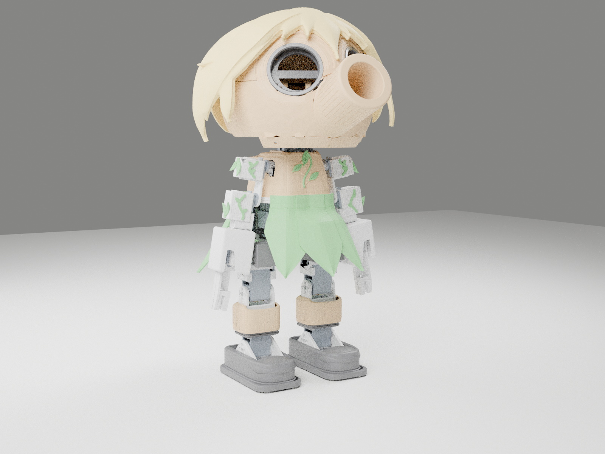
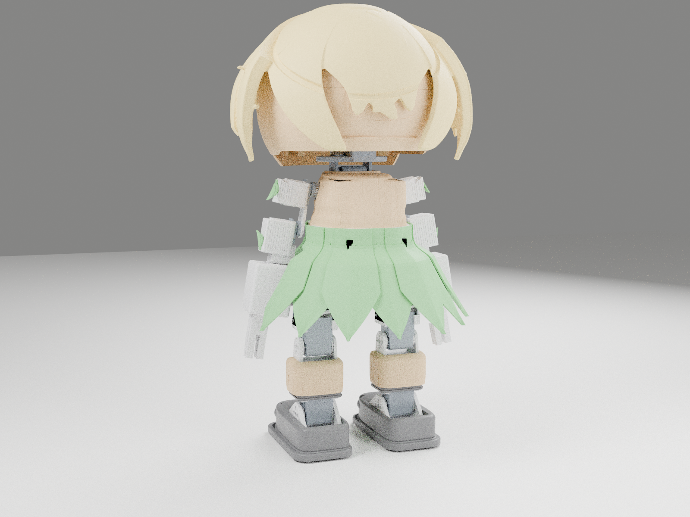
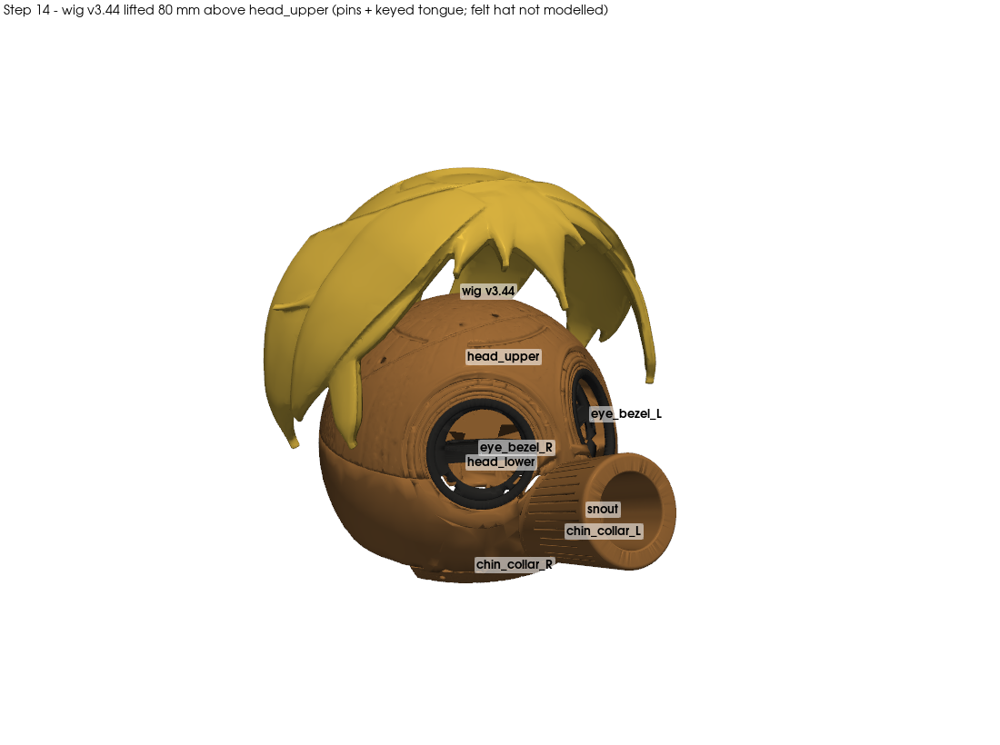
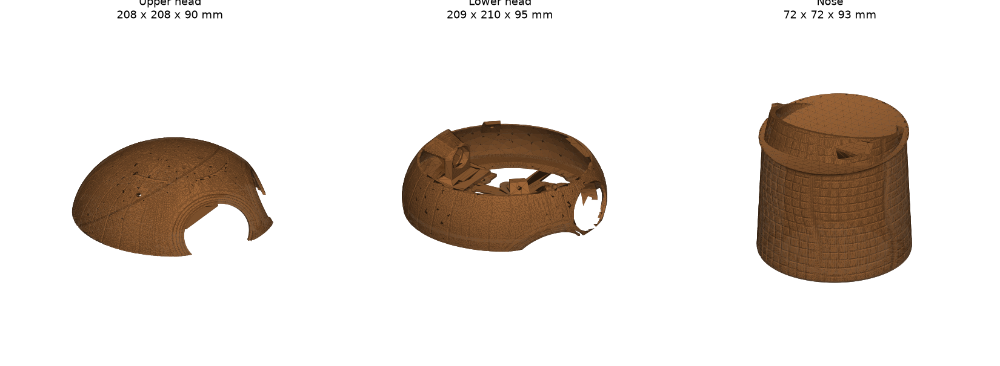
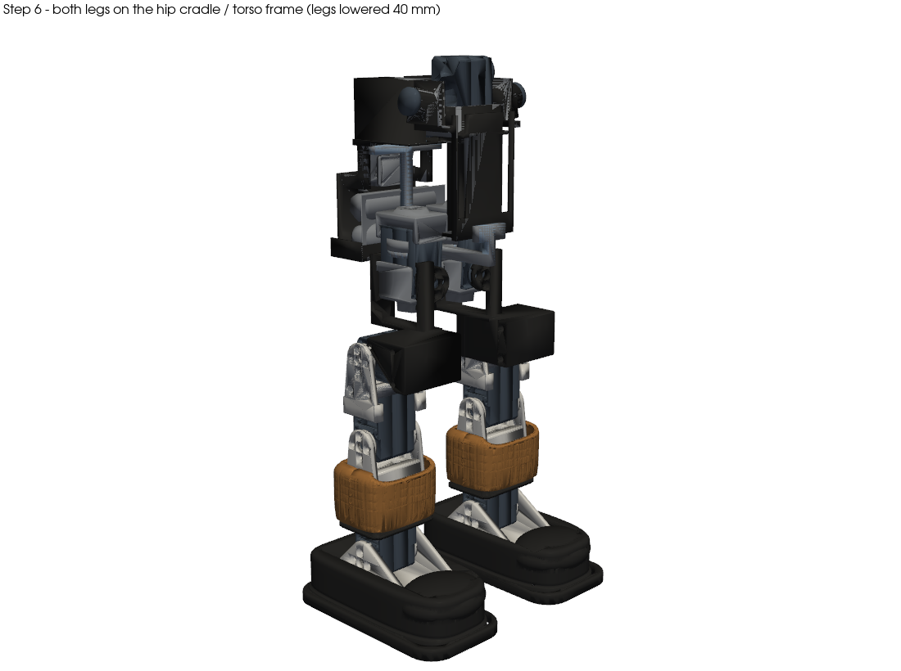
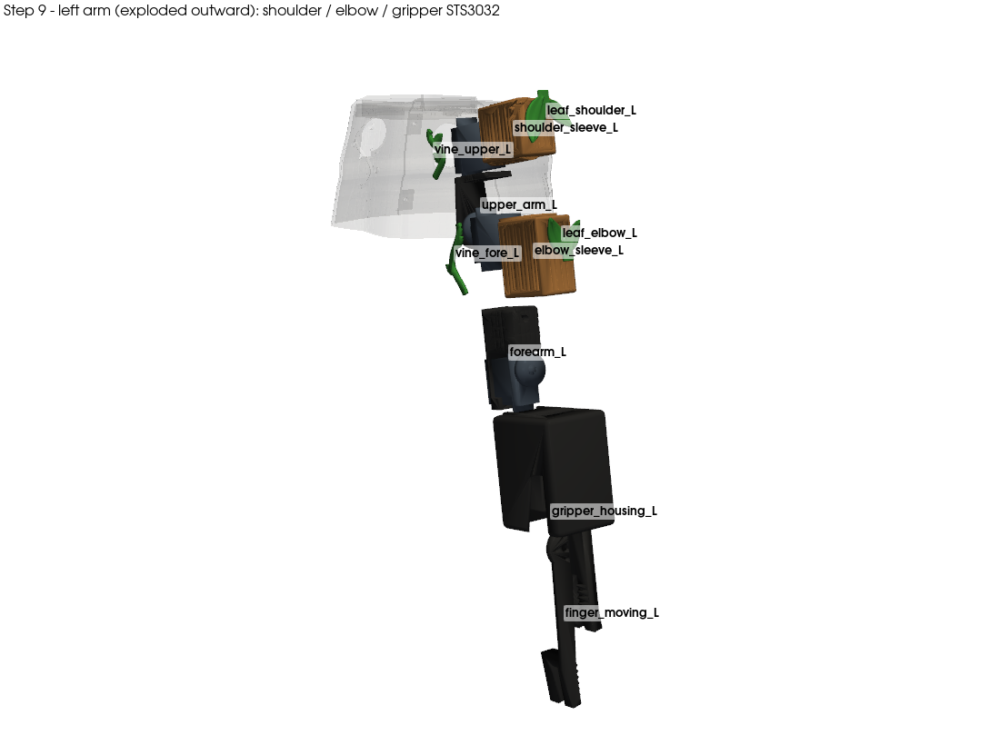
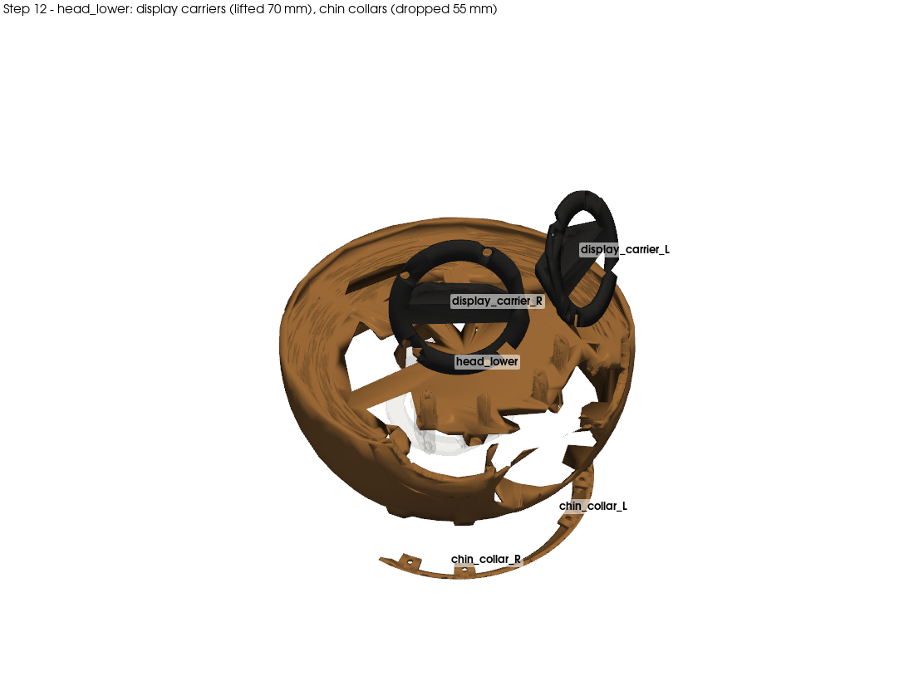

# Twiglet

**Twiglet** is a ~50 cm, 19-DoF 3D-printed biped with a wooden-ball head, two round digital eyes, a printed hair piece under a felt hat, a leaf kilt and two small arms with grippers. It is **inspired by** [Open Duck Mini](https://github.com/apirrone/Open_Duck_Mini/tree/v2) (v2), and reuses some of its open-source parts (legs, neck, electronics) under Apache-2.0 — see [NOTICE](NOTICE).

[Hardware →](#hardware) · [BOM →](docs/BOM.md) · [Print →](docs/print_guide.md) · [Assemble →](docs/assembly_guide.md) · [Simulation →](experiments/README.md) · [Contribute →](CONTRIBUTING.md)

> **Status: simulation only.** Nothing has been printed or built yet, so every number below is from MuJoCo and mesh checks. Photos and videos of a real build are TODO.

| | | |
|:-:|:-:|:-:|
|  |  |  |
| **Back view.** Body v3.34, head v3.30, hair v6.11 (v6b0), neck stand-ins | **Hair mesh in this repo: v3.44** | **Head shells and nose, v3.30** |
|  |  |  |
| **Legs on the trunk** | **3-DoF arms (STS3032)** | **Head inside: Pi, eyes, ballast** |

## Highlights

- **Head:** the big wood-textured ball (v3.30 silhouette) with a hollow nose and two 2.1" round touch LCDs as eyes (ESP32-S3; firmware in [`experiments/twiglet_eyes/`](experiments/twiglet_eyes/README.md)), on a 3-servo neck (Open Duck Mini v2-compatible). The walking model uses a **0.843 kg** head (0.84258 kg).
- **Hair:** the approved keeper is **v6.11 (v6b0)**. The README hero renders use that keeper (fringe + felt hat) from the outside viewer assembly. The hair STL is still not checked into this repository; the assembly-step wig image remains the in-repo **v3.44** mesh.
- **Body:** a slim torso cone with a 10-petal leaf kilt, shin covers and boots (body v3.34).
- **Arms:** two 3-DoF arms (shoulder, elbow, gripper) on Feetech STS3032 micro bus servos, powered from a 6 V buck regulator.
- **Simulation:** MuJoCo only, stock **STS3215** leg and neck servos at **1.91 N·m**. Sole contacts are proxy boxes. Nothing here is a hardware or strength result.

## Hardware

| Category | Item | Specification |
|---|---|---|
| Body | Size | about 340 × 276 × 499 mm (feet to hair top, rest pose; hat not modelled) |
| Body | Mass (sim model) | 2.781 kg with the 0.843 kg head (0.84258 kg). Low head 0.823 kg on a 2.761 kg model. Heavy head 0.885 kg on a 2.823 kg model. The 25 g ballast is counted once |
| Motion | Joints | 19: 10 legs + 3 neck (13 × Feetech STS3215), 6 arms (Feetech STS3032) |
| Computing | Main board | Raspberry Pi Zero 2W (as upstream) |
| Sensing | IMU | BNO055 (as upstream) |
| Interaction | Eyes | 2 × Waveshare ESP32-S3-Touch-LCD-2.1 (480 × 480 round), UART from the Pi |
| Power | Battery | 2S 18650 (2 cells) + 2S BMS; 5 V UBEC for logic and eyes; 6 V buck for the arm servos |
| Printing | Printer used for the checks | Bambu P1S (every part fits 256 × 256 × 256 mm), PLA / PETG / optional TPU |

Full parts list with links and prices: [docs/BOM.md](docs/BOM.md) (CSV: [docs/BOM.csv](docs/BOM.csv)). Several prices are still TODO.

## Simulation results

Walking file [`params/head843_earlyrate.npy`](experiments/head843_ac/params/head843_earlyrate.npy) (`d308c5f003b051b3ddd0b32d15234571bce228eae43843ccc7c86553f067e892`). Each row is its own sample. Counts are not pooled across laws, horizons, or head masses. A scope is qualified only when its own Wilson 95% lower bound is at least 99.5%. The full write-up is [`experiments/head843_ac/results/REPORT.md`](experiments/head843_ac/results/REPORT.md).

Every row uses the stock STS3215 limit of 1.91 N·m, in simulation only. Sole contacts are proxy boxes. These counts are not a hardware or strength claim.

| Scope | Seeds | Count | Wilson 95% lower | Law |
|---|---|---:|---:|---|
| Straight, nominal, 10 s, 0.843 kg | 214000–217999 | 4000/4000 | 99.90% | early-rate |
| Straight, nominal, 20 s, 0.843 kg | 218000–221999 | 4000/4000 | 99.90% | early-rate |
| Straight, low head 0.823 kg, 10 s | 210000–213999 | 3999/4000 | 99.86% | early-rate |
| Straight, heavy head 0.885 kg, 10 s | 222000–222999 | 1000/1000 | 99.62% | early-rate |
| Stop at 6 s | 245000–245999 | 1000/1000 | 99.62% | [cfg_b](experiments/head843_ac/results/head843_manoeuvre_b_val.json) |
| Restart | 280000–280999 | 1000/1000 | 99.62% | [cfg_f](experiments/head843_ac/results/head843_manoeuvre_f_val.json) |
| Slow stride ×0.7 | 247000–247999 | 1000/1000 | 99.62% | [cfg_b](experiments/head843_ac/results/head843_manoeuvre_b_val.json) |
| Stride ×1.2 | 294000–294999 | 1000/1000 | 99.62% | [cfg_h](experiments/head843_ac/results/head843_manoeuvre_h_val.json). The speed rule allows 20° of final yaw |
| +20° at 4°/s | 291000–291999 | 1000/1000 | 99.62% | [cfg_h](experiments/head843_ac/results/head843_manoeuvre_h_val.json) |
| −20° at 4°/s | 292000–292999 | 1000/1000 | 99.62% | [cfg_h](experiments/head843_ac/results/head843_manoeuvre_h_val.json) |
| +45° at 15°/s | 267000–267999 | 1000/1000 | 99.62% | [cfg_d](experiments/head843_ac/results/head843_manoeuvre_d_val.json) |
| −90° at 8°/s | 287000–287999 | 1000/1000 | 99.62% | [cfg_h](experiments/head843_ac/results/head843_manoeuvre_h_val.json) |
| Slalom ±20° at 4°/s | 290000–290999 | 1000/1000 | 99.62% | [cfg_h](experiments/head843_ac/results/head843_manoeuvre_h_val.json) |

Shoulder mean on the straight walks is 20.9°, shoulder travel about 17.9°, head yaw travel about 15.8°. Low and heavy heads were not walked for 20 s.

**Not yet qualified**

- +90°, including 8°/s on cfg_h (999/1000, Wilson lower 99.44%; seed 288059 finishes at +69.9°) and 15°/s on cfg_d (998/1000, lower 99.27%).
- −45°, at 8°/s (998/1000, lower 99.27%) and at 15°/s (999/1000, lower 99.44%). The fast −45° is the one that missed. +45° at 15°/s is the row above.
- 180°. An eight-seed −180° screen had one opposite peak of 15.3°. No thousand was opened.
- Stride ×1.3. Seed 276309 finishes at +26°.
- Seed **270260** falls at 4.33 s on a straight walk, with no turn command. It is a baseline exception, not a turn miss.

A separate copy, [`twiglet_v3_hyp_torque29.xml`](experiments/head843_ac/sim/models/twiglet_v3_hyp_torque29.xml), raises hip-pitch, knee, and ankle limits from 1.91 N·m to 2.9 N·m. The same position commands were not retuned. Straight walks then yaw by tens of degrees, and seed 270260 stays inside the fall rule while yawing +161°. That file is a what-if, not the canonical model and not a hardware result. The screen is [`head843_hyp_actuator_screen.json`](experiments/head843_ac/results/head843_hyp_actuator_screen.json).

## Where to find things

| Resource | Purpose |
|---|---|
| [docs/BOM.md](docs/BOM.md) | Parts list (upstream columns + our extra parts) |
| [docs/print_guide.md](docs/print_guide.md) | Which stock parts are still used, plus the print settings of every new part (some are **required**: the sims assume them) |
| [docs/assembly_guide.md](docs/assembly_guide.md) | 15-step build with rendered step images |
| [print/mods/Twiglet/](print/mods/Twiglet/README.md) | New STLs (print-oriented), Blender sources and build scripts |
| [mini_bdx/robots/twiglet_v334/](mini_bdx/robots/twiglet_v334/README.md) | MuJoCo model (MJCF + meshes) |
| [experiments/](experiments/README.md) | Every simulation and geometry check, how to run it, and the reference results |
| [docs/configure_motors.md](docs/configure_motors.md), [docs/sim2real.md](docs/sim2real.md), [docs/prepare_robot.md](docs/prepare_robot.md) | Servo IDs, sim-to-real notes, how the model was made |
| [docs/upstream/](docs/upstream/) | The upstream Open Duck Mini v2 docs, unchanged, for reference |

For the stock Open Duck Mini v2 parts use upstream's [Onshape CAD](https://cad.onshape.com/documents/64074dfcfa379b37d8a47762/w/3650ab4221e215a4f65eb7fe/e/0505c262d882183a25049d05) and [BOM](https://docs.google.com/spreadsheets/d/1gq4iWWHEJVgAA_eemkTEsshXqrYlFxXAPwO515KpCJc/edit?usp=sharing). The onboard runtime is upstream's [Open_Duck_Mini_Runtime](https://github.com/apirrone/Open_Duck_Mini_Runtime) (TODO: add the arm servos and the eye UART).

### Large files

Every file is under GitHub's 100 MB limit. Over 25 MB: `print/mods/Twiglet/source/blender/body_v334.blend` (59 MB). The head v3.30 `.blend` (194 MB) is not included; its rebuild scripts are in `print/mods/Twiglet/source/scripts/head_v3.30/`.

## Credits

Twiglet is **inspired by** **[Open Duck Mini](https://github.com/apirrone/Open_Duck_Mini)** (v2) by Antoine Pirrone ([apirrone](https://github.com/apirrone)) and the Open Duck Mini contributors (see [thanks.md](thanks.md)), sponsored by HuggingFace and Pollen Robotics. Some stock Open Duck Mini v2 parts, wiring diagrams and docs are reused here under the Apache License 2.0; [NOTICE](NOTICE) lists exactly which files are theirs, unmodified or modified. Thanks also to Rhoban for [BAM](https://github.com/Rhoban/bam), and to the [MuJoCo](https://github.com/google-deepmind/mujoco), [trimesh](https://github.com/mikedh/trimesh), [PyVista](https://github.com/pyvista/pyvista) and [Blender](https://www.blender.org/) projects.

This project is not affiliated with or endorsed by Pollen Robotics, HuggingFace or the Open Duck Mini project.

## License

Copyright 2026 Mike Holborn (DreamMachina).

The new material in this repository is licensed under the [Apache License 2.0](LICENSE). The Open Duck Mini v2 material stays under its own Apache-2.0 terms and copyright; see [NOTICE](NOTICE). Contributions are accepted under the same licence (see [CONTRIBUTING.md](CONTRIBUTING.md)).
